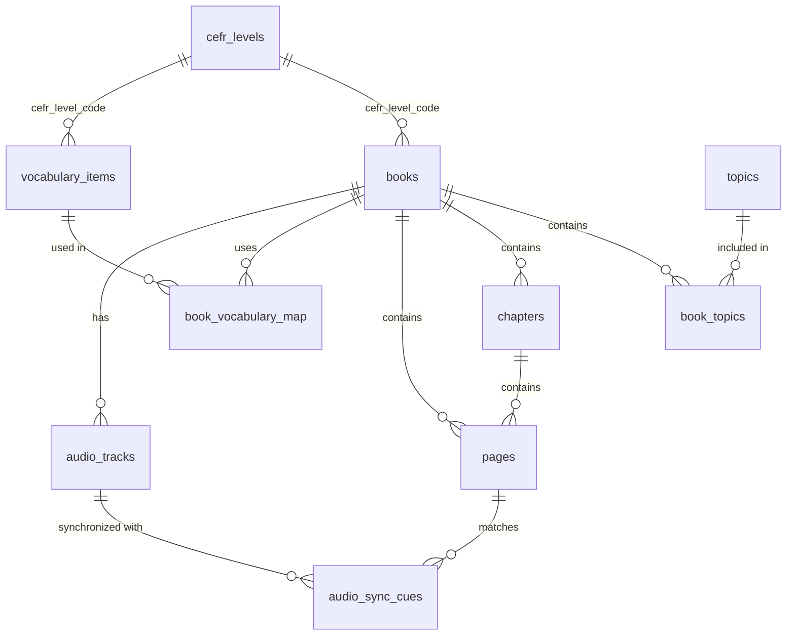

# Database Schema

This document details the database schema for the Wordloom English-learning app, powered by PostgreSQL 16 + pgvector.

## Entity Relationship Diagram

## Tables

- **cefr_levels**: Stores the 6 CEFR levels (A1, A2, B1, B2, C1, C2) along with target vocabulary size and reading ease metrics.
- **topics**: Stores the 10 thematic categories used for book classification.
- **books**: The core entity storing identity, level, length, licensing, covers, and vector embeddings. It includes an `origin` column to protect legacy data.
- **book_topics**: Junction table mapping books to their relevant topics with a relevance score.
- **chapters**: Defines chapter boundaries and titles within a book.
- **pages**: Stores the paginated content of the books, both in sanitized HTML and plain text, enforcing the 250-word-per-page rule.
- **vocabulary_items**: Stores dictionary and semantic information for extracted vocabulary words.
- **book_vocabulary_map**: Junction table recording the frequency and first appearance of vocabulary within a specific book.
- **audio_tracks** & **audio_sync_cues**: (Optional) Stores LibriVox audio tracks and WhisperX-aligned timing cues for synchronized playback.
